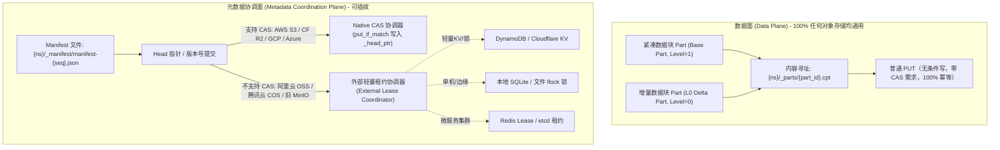
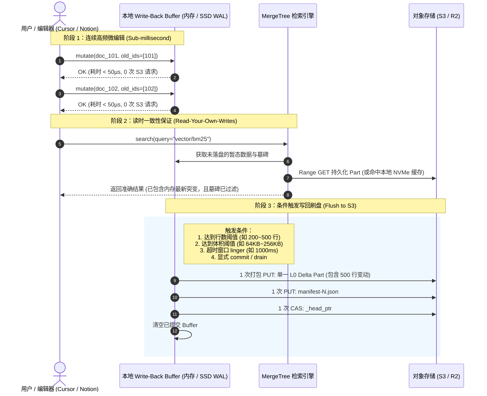

# Turbofish 泛化系统架构与多云对象存储设计白皮书

> **文档版本**: v1.1 (2026-11)
> **设计目标**: 降低 S3 原生检索系统在高频细粒度变更（代码编辑、文档突变）下的读写放大与请求成本，并处理不同对象存储的 CAS 能力差异。本文描述架构与取舍；具体性能/成本数字应在目标硬件和真实存储上复测，不作为对外承诺。

---

## 目录
1. [核心设计哲学：S3 原生 vs 传统向量数据库](#1-核心设计哲学)
2. [多云对象存储矩阵与 CAS 差异化治理](#2-多云对象存储矩阵与-cas-差异化治理)
3. [Cursor / Git-on-S3 写回缓冲（Write-Back Buffer）架构](#3-cursor--git-on-s3-写回缓冲架构)
4. [元数据缓存与生命周期管理层](#4-元数据缓存与生命周期管理层)
5. [模拟器（SimStore）高保真与精确多云计价模型演进](#5-模拟器高保真与精确多云计价模型)
6. [落地演进路线与接口契约](#6-落地演进路线与接口契约)

---

## 1. 核心设计哲学

### 1.1 对象存储是唯一的持久化真相（Sole Source of Truth）
- **无状态计算节点（Stateless Workers）**：计算节点本地盘（NVMe/SSD）和内存仅为**临时读缓存**与**暂态写回缓冲区（Write-Back WAL）**，绝对不是主存储。
- **任意节点服务任意 Namespace**：任何 Worker 可以无预热地拉取任意 Namespace 的元数据与数据切片并服务查询；计算节点崩溃、缩容或被抢占（Spot/Serverless Scale-to-Zero）时，不丢失任何已持久化数据。
- **海量 Namespace 经济学（Scale-to-Zero）**：
  在 SaaS 场景（Notion 个人知识库、Cursor 代码仓、Figma 设计文档）中，99.9% 的 Namespace 在任意 10 分钟窗口内完全无查询。
  传统架构（如 Pinecone/Milvus 每个集合常驻 Pod/内存）导致闲置成本灾难；而在 Turbofish 中，闲置 Namespace 仅以紧凑单文件形式保存在 S3 上，存储费用仅 **$0.015 ~ $0.023 / GB·月**，计算开销严格为 **$0.00**。

### 1.2 数据的不可变性与内容寻址
- 数据文件（Compact Part，包含列存、BM25 倒排链、IVF 向量聚类）一旦写入即**完全不可变**。
- 不可变 Part 使用全局唯一内容哈希或 ULID 寻址（`{ns}/_parts/{part_id}.cpt`）。
- **不可变带来的巨大红利**：
  1. **零 CAS 依赖**：数据 Part 的上传永远只需要最普通的标准 `PUT`，在全世界任何一家对象存储上 100% 兼容。
  2. **永久安全的只读缓存**：NVMe / 内存可以直接按 `part_id` 缓存切片，永不需要做复杂的缓存失效协议（Cache Invalidation）。
  3. **细粒度 HTTP Range GET**：单次查询通过单次或并行 2~3 个 Range GET 仅读取 16 字节 Trailer + Footer 目录 + 命中的倒排列表/向量切片，彻底避免全量下载。

---

## 2. 多云对象存储矩阵与 CAS 差异化治理

### 2.1 主流云厂商对象存储能力与定价矩阵

| 云厂商 / 对象存储 | 条件写 (CAS) 原生支持 | 前置条件 Header / 协议 | 出网流量费 (Egress) | Class A 请求费 (PUT/LIST) | Class B 请求费 (GET) | 存储费 (GB·月) | 特性评注与差异 |
|---|---|---|---|---|---|---|---|
| **AWS S3** | **完整支持** (2024.08 引入) | `If-Match: "<etag>"`, `If-None-Match: "*"` | $0.09/GB (公网) / $0.00 (同区) | $0.0050 / 1k | $0.00040 / 1k | $0.023 | 黄金基准，功能最完整；PUT 首字节延迟 ~50-80ms |
| **Cloudflare R2** | **完整支持** | `If-Match: "<etag>"`, `If-None-Match: "*"` | **$0.00 / GB (免费！)** | $0.0045 / 1k ($4.50/M) | $0.00036 / 1k ($0.36/M) | $0.015 | **极度推荐**；免出网费使多节点分布式读成本大幅降低 |
| **GCP Cloud Storage** | **完整支持** | `x-goog-if-generation-match: <gen>` 或 S3 XML `If-Match` | $0.12/GB (公网) / $0.00 (同区) | $0.0050 / 1k | $0.00040 / 1k | $0.020 | 原生 Generation 机制最严谨，可防重放 |
| **Azure Blob Storage**| **完整支持** | Put Blob `If-Match: "<etag>"` / `If-None-Match: "*"` | $0.087/GB (公网) / $0.00 (同区) | $0.0065 / 1k | $0.00052 / 1k | $0.018 | Hot 档请求费偏高，需尽量减少小写 |
| **阿里云 OSS** | **部分 / 无 PUT CAS** | `x-oss-forbid-overwrite: true` (仅防重名新建，不支持更新时 ETag CAS) | ~$0.07/GB (公网) / $0.00 (同区) | $0.0045 / 1k | $0.00035 / 1k | $0.017 | `PutObject` 忽略 `If-Match`，原生无法做乐观锁覆盖写 |
| **腾讯云 COS** | **部分 / 无 PUT CAS** | 仅支持分块上传完结时校验，PUT 不支持 `If-Match` | ~$0.07/GB (公网) / $0.00 (同区) | $0.0045 / 1k | $0.00035 / 1k | $0.017 | 同阿里云，不能依赖 S3 CAS 语法 |
| **MinIO / 私有云** | **因版本而异** | 部分新版本支持 `If-Match`，多数旧版/Ceph 返回 501/412 | $0.00 | $0.00 | $0.00 | 私有硬件 | 很多企业内网自建 MinIO 是旧版本，容易产生假死或覆盖丢失 |

### 2.2 结构性解耦：数据面与元数据协调面的彻底分离

- **架构公理**：
  1. 所有占用大体积、高带宽的数据 Part（`.cpt`）和历史清单（`manifest-{seq}.json`）**无论在哪个云，永远纯粹直接保存在对象存储上**。
  2. 只有单值指针 `{ns}/_head_ptr`（仅几十字节的字符串指针，如 `manifest-42`）的原子换代需要协调。
  3. **插拔策略**：
     - **环境 A（AWS / R2 / GCP / Azure）**：直接启用 `NativeCasCoordinator`，零外部依赖，直接靠 S3 条件写。
     - **环境 B（阿里云 / 腾讯云 / 兼容层 / 私有 MinIO）**：启用 `LeaseCoordinator`。所有文件依然 100% 存在 OSS/COS 上，仅 Manifest 发布时的版本仲裁向外部轻量协调器（如 1 台单核 SQLite / 共享租约表）申请 1 次乐观换代。

---

## 3. Cursor / Git-on-S3 写回缓冲（Write-Back Buffer）架构

### 3.1 为什么每 10 行编辑写一个 S3 PUT 是灾难性的？
在类似 Cursor、Notion 的场景下，用户的击键、自动保存和行编辑是极密集的（例如 10 秒内 5 次微小保存）。
如果每次 10 行改动都直接走一次 S3 流水线：
1. `PUT {ns}/_parts/{part_id}.cpt`（1 次 A 类 PUT）
2. `PUT {ns}/_manifest/manifest-{seq}.json`（1 次 A 类 PUT）
3. `CAS PUT {ns}/_head_ptr`（1 次 A 类 PUT）

**成本核算**：
- 单次小编辑 = 3 次 A 类 PUT。
- 单个活跃用户每天产生 2,000 次微编辑 = 6,000 次 PUT = $0.030 / 天 = **$0.90 / 月**。
- 若有 100 万日活用户，仅 S3 PUT 费用就高达 **$30,000 / 天（近 100 万美元/月）**！
- 同时，S3 的 PUT 延迟在 50~80ms，50 次连续小编辑在同步写入下累积延迟高达 3~4 秒。

### 3.2 Cursor 与 Git-on-S3 的核心精髓：写回微批处理（Micro-Batching WAL）

### 3.3 收益量化对比（模型估算）

下表是按固定编辑次数推导的模型估算，不是生产流量实测；实际收益取决于批大小、linger 窗口与并发写入分布。

| 指标 | 朴素实时小 PUT 方案 (未攒批) | Write-Back Buffer 写回机制 (攒批) | 优化倍数 |
|---|---|---|---|
| 50 轮 10 行微编辑的 S3 PUT 次数 | **150 次 PUT** | **3 次 PUT** (攒成 1 个 L0 Part 提交) | **节省 98.0% 的 S3 请求费** |
| 用户感知写入响应时间 | 60ms ~ 100ms (等待 S3 网络往返) | **< 100 微秒** (本地 Buffer 写入) | **快 600~1000 倍** |
| S3 数据对象碎片数 | 50 个微小碎片垃圾 Part | **1 个紧凑 Delta Part** | **碎片率降低 98%** |
| 后续后台 Compaction 压力 | 极高 (频繁合并碎片) | 极低 (规整分层) | 系统平稳无抖动 |

---

## 4. 元数据缓存与生命周期管理层

### 4.1 痛点诊断
目前系统若在每次查询时都去 S3 执行 `GET _head_ptr` 然后 `GET manifest.json`，会产生两个致命缺陷：
1. **延迟放大**：2 次 S3 往返引入 60~120ms 的强制网络开销，热查询绝对无法达到 Turbopuffer 的 10~15ms。
2. **B 类读成本翻倍**：每个检索请求平白无故多消耗 2 次 S3 GET 请求费。

### 4.2 架构解法：租约与版本化元数据缓存（CachedManifestStore）
1. **Writer 节点本地直读直改**：
   - 当某个 Worker 负责该 Namespace 的写入与写入缓冲时，它是该 Namespace 的当前持有者。
   - 其内存中的 `Manifest` 状态即为权威状态，查询直接走内存元数据，**0 次 S3 GET**。
2. **Reader 节点的 TTL 租约与条件校验**：
   - Worker 缓存在内存中的 `Manifest` 附带 `ttl_ms`（默认 500ms ~ 2000ms）和 `version_etag`。
   - 在租约有效期内，所有读请求完全从本地内存元数据路由，**零网络请求**。
   - 租约过期后，发起带有 `If-None-Match` 的条件 GET：
     - 若未发生变更，S3 返回 `304 Not Modified`（0 字节负载，无 JSON 解析开销）；
     - 仅当真正有其他 Worker 提交了新版本时，才重拉新 Manifest。

---

## 5. 模拟器（SimStore）高保真与精确多云计价模型

模拟器用于离线比较不同存储层与请求模式，避免把本地内存速度误当成云存储延迟。它是模型，不是真实 S3 的替代品。

### 5.1 对数正态长尾采样
早先的两点均匀近似会把取值限制在固定区间内，无法表达 p99 / p99.9 长尾。
- **采样算法**：采用 Box-Muller 变换：
  $$z = \sqrt{-2.0 \ln(u_1)} \cos(2\pi u_2)$$
  生成标准高斯分布 $N(0, 1)$，再乘以可配置的偏态参数 $\sigma$：
  $$\text{Latency} = p50 \times \exp(\sigma \times z) + \text{WAN Jitter} + \text{Tail Spike}$$
  默认参数是公开资料下的近似，不代表任何特定区域或时段的 S3 实测分布。

### 5.2 缓存延迟可调模式（S3-Representative Cache Delay）
为了在不需要昂贵真实 S3 环境、离线或本地单机开发下也能测出真实的系统全流程延迟：
- 新增 `cache_remote_delay_factor` 与 `cache_s3_latency_p50_us` 配置：
  当开启“S3 对齐模式”时，即便本地命中了缓存，也会注入与真实网络相拟合的等效网络延迟。
  这样可以避免把本地 NVMe 命中速度当成云上端到端延迟。

### 5.3 多云原生计价体系与 A/B 类请求分离审计
`SimSnapshot` 不再只输出一个模糊的总金额，而是提供精细化的账单分解：
- **A 类操作（Class A Requests）**：精确统计 `puts` + `lists` 次数及各自费用；
- **B 类操作（Class B Requests）**：精确统计 `gets`、`head` 次数及费用；
- **多云预置 Profile**：
  - `aws_default()`：AWS S3 Standard 费率（A 类 $0.005/1k，B 类 $0.0004/1k，出网 $0.09/GB）；
  - `cloudflare_r2()`：Cloudflare R2 费率（A 类 $0.0045/1k，B 类 $0.00036/1k，**出网 $0.00/GB**）；
  - `gcp_standard()`：Google Cloud Storage Standard 费率；
  - `azure_hot()`：Azure Blob Storage Hot 档费率；
  - `aliyun_oss()`：阿里云 OSS 标准存储费率。

---

## 6. 演进方向

### 6.1 模块划分
1. **Step 1: 升级模拟器 `simstore`**
   - 替换长尾分布采样为 Box-Muller，支持真实长尾分位数；
   - 增加多云配置模板（AWS / R2 / GCP / Azure / 阿里云）；
   - 输出 Class A 与 Class B 细分账单快照；
   - 支持缓存远端等效延迟注入。
2. **Step 2: 建立元数据缓存与写回缓冲区 `WriteBackBuffer`**
   - 实现包含时间阈值（linger）、行数阈值（max_rows）、体积阈值（max_bytes）的三重写回缓冲区；
   - 读路径实现对已持久化 Part 与内存未落盘 Buffer 的透明融合查询（Read-Your-Own-Writes）；
   - 将 50 轮连续小突变实测压缩至仅 1~2 个 S3 PUT。
3. **Step 3: 抽象 `HeadCoordinator` 接口**
   - 提供 `NativeCasCoordinator`（用于 AWS S3 / R2 / GCP / Azure）；
   - 提供 `LeaseCoordinator`（用于国内云与自建 MinIO 等非 CAS 存储）；
   - 端到端通过离线高保真模拟验证。
