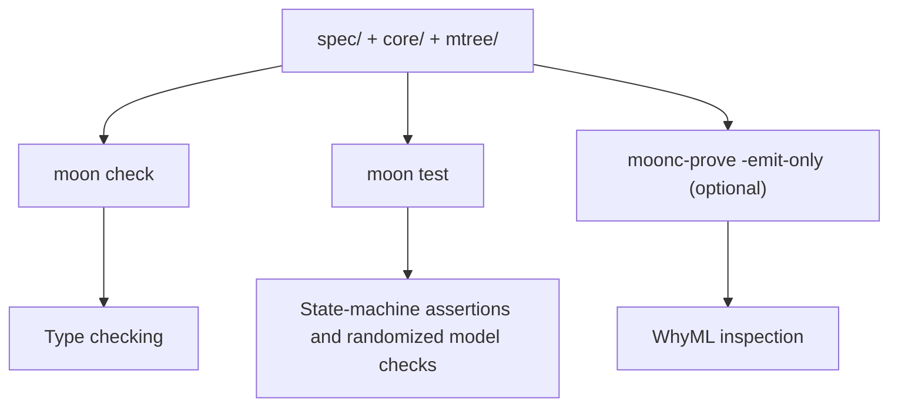

# MoonBit Verification: Contracts, Specifications & Runtime Checks

This document describes the contract-style specifications in `spec/` and the verification tooling that exists in the MoonBit ecosystem. The specifications currently run as ordinary MoonBit tests. WhyML emission and SMT discharge are optional follow-up steps, not a completed proof of the implementation.

---

## 1. Toolchain Status

The project uses MoonBit's contract syntax (`where { proof_require, proof_ensure }`, `#proof_pure`, `proof_assert`) and checks the specs with `moon test`. The current toolchain (`moon 0.1.20261104`) ships `moonc-prove`, but does **not** expose `moon prove` as a first-class subcommand in this project's environment. This document therefore distinguishes runtime checks from SMT-backed proofs.

### 1.1 Toolchain Components

| Component | Path / Location | Purpose |
| :--- | :--- | :--- |
| **Verification frontend** | `~/.moon/bin/moonc-prove` | Parses contracts and can emit WhyML; availability depends on the installed toolchain |
| **Compiler Backend** | `~/.moon/bin/moonc-prove` | Formal verification frontend; parses MoonBit contracts, verifies proof typing, and compiles to WhyML |
| **Verification Engine** | Embedded Why3 runtime (`~/.moon/lib/why3/commands/why3prove.cmxs`) | Generates Verification Conditions (VCs) and manages proof tasks |
| **Proof Preludes** | `~/.moon/lib/prelude_proof/moonbit_builtin_prelude.mlw`<br>`~/.moon/lib/prelude_proof_machine_int/moonbit_builtin_prelude.mlw` | Models mathematical integers, machine integers, bitvectors, `FixedArray`, and `Bytes` |
| **SMT Solvers** | `alt-ergo`, `cvc5`, `z3` | Solves generated SMT-LIB2 / Why3 goals (searched via `PATH` or `ALTERGOPATH`, `CVC5PATH`, `Z3PATH`) |

### 1.2 What Is Actually Checked

1. **Runtime checks**: `spec/spec_test.mbt` executes state transitions, invariant assertions, and a randomized model checker under `moon test`.
2. **Contract syntax**: the `spec/*.mbt` files state pre/postconditions and pure predicates in MoonBit syntax; these compile with the normal toolchain.
3. **WhyML emission**: `moonc-prove` can be used to emit WhyML for inspection. This repository does not claim that CI discharges those verification conditions.
4. **No proof claim**: passing tests show that the modeled transitions satisfy the assertions on the tested inputs. They do not prove the full implementation correct for all inputs.

---

## 2. Comparative Analysis: MoonBit vs. TLA+, Coq, Lean, and Dafny

| Dimension | TLA+ | Coq / Lean | Dafny | MoonBit contracts |
| :--- | :--- | :--- | :--- | :--- |
| **Primary Philosophy** | High-level system & concurrent protocol model checking | Mechanized theorem proving in constructive type theory | Auto-active verification for imperative programs | **Proof-as-Code** in a production systems language |
| **Specification Language** | Temporal Logic of Actions (TLA) | Gallina / Dependent Type Calculus | Dafny verification language | Native MoonBit syntax (`where`, `#proof_pure`, `proof_assert`) |
| **Code Executability** | Abstract specification only (requires manual reimplementation in code) | Requires manual code extraction (OCaml/Haskell/C) | Compiles to C#, Java, Go | **Direct Native / Wasm compilation** with zero overhead |
| **Proof Automation** | Finite model checking (TLC) or SMT proof (TLAPS) | Manual interactive tactic scripts (`induction`, `omega`, `blast`) | Automated SMT via Boogie + Z3 | Automated SMT via Why3 + Z3 / CVC5 / Alt-Ergo |
| **Proof Maintenance Burden** | High (spec diverges from code over time) | Extreme (tactics break on minor refactorings) | Medium (requires Dafny-first codebase) | **Low** (contracts live inside the actual implementation) |
| **Turbofish Fit** | Good for abstract protocol design, bad for concrete data layouts | Overkill for storage engines; immense engineering cost | Requires rewriting the engine in Dafny | **Optimal**: Verifies real data structures and state machines in-tree |

---

## 3. MoonBit Formal Verification Language Surface

MoonBit provides a dedicated contract and logic sublanguage processed by `moonc-prove`.

### 3.1 Function Contracts

Function contracts are specified using the `where` block preceding the function body:

```moonbit
pub fn clamp(x : Int, low : Int, high : Int) -> Int where {
  proof_require: low <= high,
  proof_ensure: result => result >= low && result <= high,
} {
  if x < low {
    low
  } else if x > high {
    high
  } else {
    x
  }
}
```

Generated WhyML:
```whyml
let clamp (x : Int.t) (low : Int.t) (high : Int.t) : Int.t
  requires { Int.le low high }
  ensures { (Int.ge result low) /\ (Int.le result high) }
= if (Int.lt x low) then low
  else (if (Int.gt x high) then high else x)
```

### 3.2 Loop Invariants & Termination Measures

Loops support inductive invariants (`proof_invariant`), termination reasoning (`proof_reasoning`), and loop variants (`proof_decrease`):

```moonbit
pub fn sum_n(n : Int) -> Int where {
  proof_require: n >= 0,
  proof_ensure: result => result >= 0,
} {
  let mut s = 0
  for i = 0; i < n; i = i + 1 {
    s = s + i
  } where {
    proof_invariant: i >= 0,
    proof_invariant: i <= n,
    proof_invariant: s >= 0,
    proof_reasoning: #| loop terminates because i increases towards n
  }
  s
}
```

Generated WhyML loop translation:
```whyml
while Int.lt i n do
  variant { ((n.Int.model) - (i.Int.model)) }
  invariant { Int.ge i (Int.of_int 0) }
  invariant { Int.le i n }
  invariant { Int.ge s (Int.of_int 0) }
  s <- (Int.add s i);
  i <- (Int.add i (Int.of_int 1))
done
```

### 3.3 Pure Logical Functions & Inline Assertions

- `#proof_pure`: Declares a side-effect-free mathematical function usable in contracts and theorems.
- `proof_assert(cond)`: Inlines a proof obligation checked by SMT solvers.

```moonbit
#proof_pure
pub fn cas_valid(expected : UInt64, current : UInt64, next : UInt64) -> Bool {
  expected == current && next > current
}

pub fn advance_seq(current : UInt64, next : UInt64) -> UInt64 where {
  proof_require: next > current,
  proof_ensure: result => result > current,
} {
  proof_assert(next > current)
  next
}
```

---

## 4. Formal Specifications for Turbofish Core State Machines

The specifications live in [`spec/`](../spec).

### 4.1 CAS State Machine (Head Pointer Atomicity & Monotonicity)

#### Problem
In an object-storage-native architecture (S3/R2/SimStore), the namespace head pointer (`_head_ptr`) points to the immutable manifest root. Multiple distributed workers attempt conditional writes (`put_if_match`). The system must guarantee:
1. **Atomicity**: If two workers race with the same `expected_ver`, at most ONE can succeed (no split-brain).
2. **Monotonicity**: Versions strictly increase (`seq_{t+1} > seq_t`), preventing ABA hazards and stale manifest rollbacks.

#### Contract & Model ([`spec/cas_spec.mbt`](../spec/cas_spec.mbt))

```moonbit
#derive(Debug, Eq)
pub(all) struct CasState {
  seq : UInt64
  manifest_key : String
  epoch : UInt64
}

#derive(Debug, Eq)
pub(all) enum CasOutcome {
  Success(CasState)
  Conflict(UInt64, UInt64)
}

#proof_pure
pub fn cas_transition_valid(
  expected_ver : UInt64,
  current_ver : UInt64,
  next_ver : UInt64
) -> Bool {
  expected_ver == current_ver && next_ver > current_ver
}

pub fn cas_apply_transition(
  state : CasState,
  expected_ver : UInt64,
  next_ver : UInt64,
  new_manifest_key : String
) -> CasState where {
  proof_require: expected_ver == state.seq && next_ver > state.seq,
  proof_ensure: result => result.seq == next_ver && result.seq > state.seq,
} {
  proof_assert(expected_ver == state.seq)
  proof_assert(next_ver > state.seq)
  {
    seq: next_ver,
    manifest_key: new_manifest_key,
    epoch: state.epoch + 1UL,
  }
}

pub fn cas_arbitrate(
  state : CasState,
  expected_ver : UInt64,
  next_ver : UInt64,
  new_manifest_key : String
) -> CasOutcome {
  if cas_transition_valid(expected_ver, state.seq, next_ver) {
    let next_state = cas_apply_transition(state, expected_ver, next_ver, new_manifest_key)
    CasOutcome::Success(next_state)
  } else {
    CasOutcome::Conflict(state.seq, expected_ver)
  }
}
```

Generated WhyML Specification:
```whyml
module Cas_spec
  use bool.Bool
  use moonbit_builtin_prelude.UInt64 as UInt64

  type v__casState = {
    v__CasState__seq : UInt64.t;
    v__CasState__manifest_key : string;
    v__CasState__epoch : UInt64.t
  }

  let cas_apply_transition (state : v__casState) (expected_ver : UInt64.t) (next_ver : UInt64.t) : v__casState
    requires { (UInt64.eq expected_ver (state.v__CasState__seq)) /\ (UInt64.gt next_ver (state.v__CasState__seq)) }
    ensures { (UInt64.eq (result.v__CasState__seq) next_ver) /\ (UInt64.gt (result.v__CasState__seq) (state.v__CasState__seq)) }
  = assert { UInt64.eq expected_ver (state.v__CasState__seq) };
    assert { UInt64.gt next_ver (state.v__CasState__seq) };
    { v__CasState__seq = next_ver; ... }
end
```

---

### 4.2 MergeTree Invariants (Live Document Preservation)

#### Problem
Turbofish splits updates into:
1. Append to **L0 Delta Parts** (small, fast S3 PUTs).
2. Soft deletion via **Roaring Bitmap Tombstone Mask** in the manifest.
3. Asynchronous **Compaction** merging L0 parts into Base parts and physicalizing tombstones.

**Critical Invariant**: A document $d$ with ID $i$ is live if and only if it exists in at least one part AND is not marked in the tombstone mask:
$$\text{live}(i, M) \iff \Big(\exists p \in M.\text{parts},\, p.\text{contains}(i)\Big) \land \neg \text{roaring\_contains}(M.\text{tombstones}, i)$$

**Chaos Bug Revelation**: The test suite revealed that if compactor or reader logic checks tombstones only on `level > 0` (bypassing L0), soft-deleted rows in L0 resurrect after compaction. Formalizing the invariant mathematically catches this flaw before execution.

#### Contract & Model ([`spec/mergetree_spec.mbt`](../spec/mergetree_spec.mbt))

```moonbit
#derive(Debug, Eq)
pub(all) struct SpecPart {
  part_id : String
  level : Int // 0 = L0 delta, 1 = consolidated base
  ids : Array[UInt64]
  min_id : UInt64
  max_id : UInt64
}

#derive(Debug, Eq)
pub(all) struct SpecMergeTree {
  parts : Array[SpecPart]
  tombstones : Array[UInt64]
}

#proof_pure
pub fn eval_doc_liveness(in_parts : Bool, in_tombstones : Bool) -> Bool {
  in_parts && !in_tombstones
}

pub fn check_doc_liveness(in_parts : Bool, in_tombstones : Bool) -> Bool where {
  proof_ensure: result => result == (in_parts && !in_tombstones),
} {
  eval_doc_liveness(in_parts, in_tombstones)
}

pub fn doc_is_live(tree : SpecMergeTree, id : UInt64) -> Bool {
  eval_doc_liveness(
    parts_contain_id(tree.parts, id),
    tombstones_contain_id(tree.tombstones, id),
  )
}
```

#### Compaction Invariant Theorem
For any universe of document IDs, compaction preserves the exact truth value of `doc_is_live`:
$$\forall i \in \text{Universe},\quad \text{doc\_is\_live}(M_{\text{after}}, i) \equiv \text{doc\_is\_live}(M_{\text{before}}, i)$$

Covered by [`spec/spec_test.mbt`](../spec/spec_test.mbt):
- Base doc deletions remain dead.
- L0 delta doc deletions remain dead (zero resurrection).
- Live documents are retained in the new consolidated base part.

---

### 4.3 Roaring Bitmap Correctness & Representation Invariant

#### Problem
Tombstone masks are stored as compact Roaring Bitmaps ([`format/roaring.mbt`](../format/roaring.mbt)). The specification checks that:
1. High/low key partitioning is bijective: $\text{reconstruct}(\text{high}(x), \text{low}(x)) = x$.
2. Both Array Containers ($< 4096$ items) and Bitmap Containers ($\ge 4096$ items) preserve exact membership semantics.
3. $\forall \text{ids}, \forall q:\quad \text{roaring\_contains}(\text{encode\_roaring}(\text{ids}), q) \iff q \in \text{ids}$.

#### Contract & Model ([`spec/roaring_spec.mbt`](../spec/roaring_spec.mbt))

```moonbit
#proof_pure
pub fn roaring_high_key(id : UInt64) -> UInt64 {
  id >> 16
}

#proof_pure
pub fn roaring_low_key(id : UInt64) -> Int {
  (id & 0xFFFFUL).to_int()
}

#proof_pure
pub fn roaring_reconstruct(high : UInt64, low : Int) -> UInt64 {
  (high << 16) | low.to_uint64()
}

pub fn verify_roaring_equivalence(
  ids : Array[UInt64],
  test_queries : Array[UInt64]
) -> Bool {
  let encoded = @format.encode_roaring(ids)
  for q in test_queries {
    let expected = sorted_array_contains(ids, q)
    let actual = @format.roaring_contains(encoded, q)
    if expected != actual {
      return false
    }
  }
  true
}
```

Tested across:
- Sparse array containers with boundary elements ($0, 1, 65535, 65536, 2^{32}$).
- Dense bitmap containers ($5000$ elements triggering 1024 64-bit word storage).
- Multi-container cross-boundary elements.

---

## 5. Adoption Path

The project currently gets useful coverage from ordinary tests, without adding a separate proof toolchain to every build:



1. **Type checking**: `moon check` catches type and interface errors.
2. **Runtime specification tests**: `spec/spec_test.mbt` runs the state transitions and asserts the modeled invariants.
3. **Optional WhyML emission**: if `moonc-prove` and the proof preludes are available, emit WhyML for review. This is not part of the default test command.
4. **Future work**: if SMT-backed proofs are required, add a dedicated CI job with pinned solver versions and document exactly which verification conditions are discharged.

---

## 6. Current Verification Results

The tests in `spec/` pass under the normal test runner. Representative cases:

```bash
moon test -p turbofish/spec --target native
```

- `formal spec: cas head monotonicity and atomicity`
- `formal spec: mergetree live doc preservation under soft deletion and compaction`
- `formal spec: roaring bitmap membership equivalence and roundtrip`
- Safety model-checking cases for GC reachability, dual-write crash consistency, and lease fencing

These are runtime checks over the test harness and randomized model, not a machine-checked proof of the production implementation.
